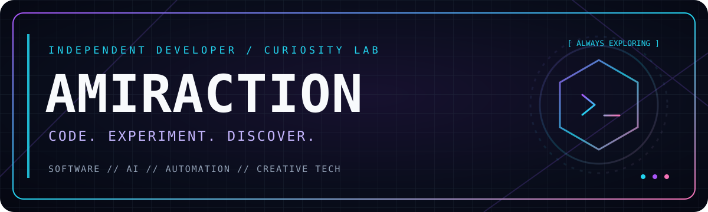

 

# Hey, I'm amiraction

**I build tools, automate workflows, and explore the space between code and creativity.**

*Curiosity-driven development. Practical systems. A little bit of chaos.*

---

## `// ABOUT`

I'm an independent developer interested in building useful software, connecting systems, and experimenting with technology.

- Building practical tools and side projects
- Exploring local AI and developer workflows
- Interested in automation, privacy, and browser security
- Experimenting with creative technology and 3D

## `// FEATURED PROJECTS`

<table>
<tr>
<td width="50%" valign="top">

### Corsair Unbound

**A local-first browser security and privacy toolkit.**

- Navigation and redirect protection
- Suspicious-page heuristics
- Download and iframe safeguards
- Privacy controls and Fortress Mode

[**Explore repository →**](https://github.com/amiraction0938/Corsair-Unbound)

</td>
<td width="50%" valign="top">

### AniVault

**A Telegram-based anime archive and delivery system.**

- Archive indexing and search
- Telegram automation
- Structured media delivery
- Server-side tooling

Private project

</td>
</tr>
</table>

## `// TECH & INTERESTS`

## `// THE RULE`

> Build with curiosity. Ship with intention. Keep learning.

**`END OF TRANSMISSION // SEE YOU IN THE NEXT BUILD`**

